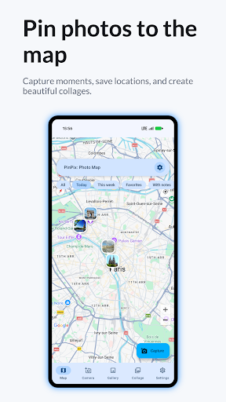
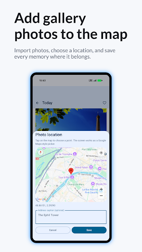
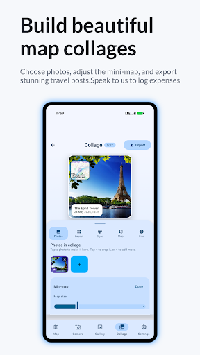
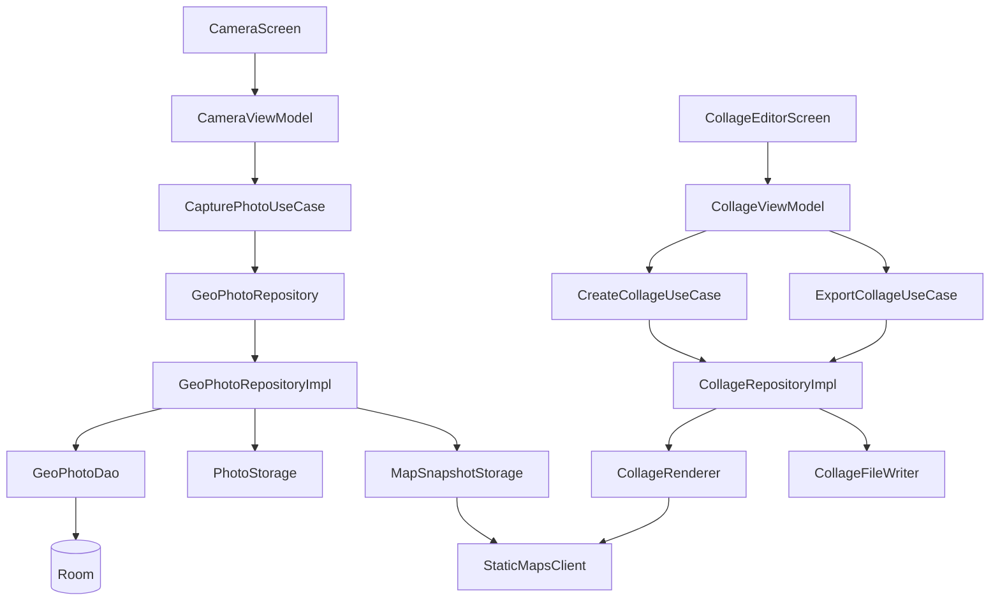

# GeoStamp Camera · MapShots

**A photo journal that keeps images connected to places, then turns them into shareable map collages.**

Capture a picture, keep its available GPS reading, browse it on a map, and combine photographs, location labels and editable text in a PNG composition. Existing images can also be imported individually and assigned a location manually.

[Google Play](https://play.google.com/store/apps/details?id=com.ilya.safarshots) · [Engineering decisions](#engineering-decisions) · [Architecture](#architecture) · [Build and run](#build-and-run)

`com.ilya.safarshots` · Android 7.0+ / API 24 · Kotlin · Jetpack Compose · CameraX · Room · Hilt

## In the app

| Explore saved places | Import and assign a location | Compose and export |
|:---:|:---:|:---:|
|  |  |  |

These are the published product's Google Play screenshots, including their original promotional framing. They are not new device-test captures. [Asset sources](docs/portfolio/SOURCES.md).

## Capabilities

- **Capture with context.** CameraX preview and capture, front/back camera controls, precise or approximate location status, and saving when GPS is unavailable.
- **Build a local photo journal.** A date-grouped gallery, favorites, notes, sharing, deletion, and filters for recent photos or missing locations. Edit or remove a saved position from photo details.
- **Import without broad gallery access.** Select one existing image with Android's photo picker, copy it into app-owned storage, and optionally choose a location. The journal records import time; it does not reconstruct the original capture date or GPS from imported EXIF.
- **Design a composition.** Six layouts: photo with map, vertical split, horizontal split, grid, magazine and postcard. Choose square, portrait or landscape ratios, a photo or solid background, and independent photo, map, caption and text layers.
- **Manipulate layers directly.** Move, resize and rotate cards and text; adjust caption visibility, coordinates, dates, colors, borders and backgrounds.
- **Export locally.** Render PNG from original image data and share through Android. On Android 10+, exports use MediaStore's pending-item lifecycle in `Pictures/PinPix`.
- **Choose the app language.** English, Hindi, Indonesian and Urdu resources with per-app locale selection. Settings use SharedPreferences exposed through StateFlow.

## Engineering decisions

### 1. Save the photo before generating its expensive derivatives

The shutter path should not wait for thumbnail decoding or a network map request. [GeoPhotoRepositoryImpl](app/src/main/java/com/ilya/safarshots/data/repository/GeoPhotoRepositoryImpl.kt) reads image bounds and orientation, inserts the Room entity, and launches thumbnail, color-seed and map-snapshot enrichment in an application-scoped coroutine. DAO updates flow back to the gallery and editor.

[PhotoStorage](app/src/main/java/com/ilya/safarshots/data/storage/PhotoStorage.kt) uses sampled bitmap decoding and orientation-aware cropping for 512 px thumbnails. This separates the durable photo record from optional presentation data. The enrichment scope uses `SupervisorJob` and IO dispatching; it survives leaving the screen, but it is not durable across process death and has no persistent retry queue.

### 2. Use one normalized layout model for preview and export

[CollageOptions and layer models](app/src/main/java/com/ilya/safarshots/domain/model/CollageTemplate.kt) store relative coordinates, widths and rotation. Compose provides interactive overlays; [CollageRenderer](app/src/main/java/com/ilya/safarshots/feature/collage/CollageRenderer.kt) draws the corresponding bitmap with Android Canvas.

[CollageViewModel](app/src/main/java/com/ilya/safarshots/feature/collage/CollageViewModel.kt) cancels the previous preview job when options change, keeps the existing preview visible during rendering, and prunes cards when selected photos disappear. [Export sizing](app/src/main/java/com/ilya/safarshots/feature/collage/CollageExportSize.kt) accounts for EXIF rotation and fits the requested aspect ratio within the reference photograph's dimensions without upscaling that reference.

This supports resolution-independent editing while keeping export independent of a UI screenshot. Large source photographs still require a correspondingly large output bitmap; the implementation does not impose a global export-memory budget.

### 3. Keep useful exports available when map services fail

[StaticMapsClient](app/src/main/java/com/ilya/safarshots/data/maps/StaticMapsClient.kt) uses HTTP connection/read timeouts and a synchronized, six-entry access-ordered bitmap cache. [MapSnapshotStorage](app/src/main/java/com/ilya/safarshots/data/maps/MapSnapshotStorage.kt) also stores a per-photo snapshot on disk.

The renderer reuses a matching snapshot, requests a fresh static map when options differ, then falls back to an existing snapshot or a schematic drawing when the request fails. The schematic is a visual location diagram, not accurate street cartography. This gives the export path an explicit degradation strategy rather than making a network request a prerequisite for every composition.

### 4. Treat location as optional data with explicit provenance

[AndroidLocationClient](app/src/main/java/com/ilya/safarshots/core/location/AndroidLocationClient.kt) checks fine/coarse permission, requests a fresh fused location with a timeout, and can fall back to the last known fix. [CameraViewModel](app/src/main/java/com/ilya/safarshots/feature/camera/CameraViewModel.kt) briefly requests a location when a newly granted permission has not yet reached its observer. Coordinates, accuracy, provider and approximate-location status are stored separately from the image.

Manual location changes invalidate the cached map snapshot. [AddressResolver](app/src/main/java/com/ilya/safarshots/core/location/AddressResolver.kt) runs Android Geocoder on IO and tolerates missing results. Last-known locations have no explicit maximum-age check, so users should review the recorded position.

### 5. Coordinate an optional external SDK through explicit state

[DuntaSdkController](app/src/main/java/com/ilya/safarshots/core/dunta/DuntaSdkController.kt) bridges SDK consent, notification permission, settings and UI state. The support mode shares network resources for public web data; it is separate from the photo journal. [Recovery work](app/src/main/java/com/ilya/safarshots/core/dunta/SupportModeRecoveryWorker.kt) uses unique periodic jobs with network/charging constraints and a mutex around restart attempts. Recovery is cancelled when the mode is disabled or battery exemption is absent.

This integration requires the local AAR and configured identifiers. A periodic interval is an Android scheduling request, not a guarantee of execution every 15 minutes.

## Architecture

There is one Gradle application module. Feature packages contain Compose screens and Hilt-created ViewModels. Use cases call domain repository interfaces; Hilt binds them to Room/file/network-backed implementations. ViewModels expose StateFlow for screen state and, where needed, SharedFlow for one-off effects.



For example, a successful CameraX callback enters `CameraViewModel`, obtains optional location, and calls `CapturePhotoUseCase`. The repository saves the entity and returns its identifier; a navigation effect opens collage selection. Later thumbnail/map updates arrive through Room Flow without rebuilding the journal manually.

The boundaries are pragmatic: the collage repository imports a renderer in the `feature` package, the domain model contains Android resource annotations, and some ViewModels access repositories or storage directly. Packages are not independently compiled modules. `SavedStateHandle` restores route arguments; a complete editable collage draft is not persisted across process recreation.

### Technology in use

| Tool | Responsibility |
|---|---|
| Compose, Material 3, Navigation Compose | Screens, interactive layers, back stack and destination arguments |
| CameraX + ExifInterface | Camera capture, orientation metadata, GPS EXIF writing |
| Room + KSP | Photo/export metadata, observable queries, explicit schema 1 → 2 migration |
| Hilt | Application services, repository bindings and ViewModel construction |
| Coroutines + Flow | UI state, database observation, IO and background enrichment |
| Google Maps Compose + fused location | Photo markers, location selection and device position |
| Android Geocoder + HttpURLConnection | Address lookup and Static Maps requests |
| Coil | Loading local photographs in Compose |
| MediaStore + FileProvider | Exporting PNG and granting temporary share access |
| WorkManager | Optional support-mode recovery, not photo enrichment |

## Code map

| Location | Responsibility |
|---|---|
| [feature/](app/src/main/java/com/ilya/safarshots/feature/) | Camera, gallery, map, detail, collage and settings screens |
| [domain/](app/src/main/java/com/ilya/safarshots/domain/) | Photo/layer models, repository contracts and use cases |
| [data/](app/src/main/java/com/ilya/safarshots/data/) | Room, repository implementations, bitmap/file storage and static maps |
| [core/](app/src/main/java/com/ilya/safarshots/core/) | Location, locale, permissions, settings, sharing and SDK lifecycle |
| [di/](app/src/main/java/com/ilya/safarshots/di/) | Hilt providers, bindings and database migration |
| [navigation/AppNavGraph.kt](app/src/main/java/com/ilya/safarshots/navigation/AppNavGraph.kt) | Top-level destinations and photo/collage route arguments |
| [test/](app/src/test/java/com/ilya/safarshots/) · [androidTest/](app/src/androidTest/java/com/ilya/safarshots/) | Model, mapper, export-size, date-grouping, EXIF and gesture tests |

## Build and run

The checked-in configuration uses Gradle **9.2.1**, Android Gradle Plugin **9.0.1**, a **JDK 21** daemon, Android SDK **36.1** for compilation, target API **36**, and minimum API **24**. Java source compatibility is 11; it does not select the Gradle runtime. Open this directory as an Android Studio project or use the wrapper.

1. Install the required Android SDK and configure its path through Android Studio or an untracked `local.properties`.
2. Ensure `app/libs/dunta_sdk-release.aar` is present; source imports its API even when support mode is unconfigured.
3. Add configuration locally, without committing real values:

   ```properties
   MAPS_API_KEY=<your Maps key>
   DUNTA_PARTNER_ID=0
   DUNTA_APPLICATION_ID=0
   ```

   `MAPS_API_KEY` is read from `local.properties`. Enable Maps SDK for Android for interactive maps and Maps Static API for server-rendered mini-maps. Empty configuration leaves real maps unavailable; the collage renderer can use its schematic fallback. Dunta identifiers may instead be supplied as Gradle properties; zero disables the configured SDK path.

4. Build and run checks:

   ```bash
   ./gradlew :app:assembleDebug
   ./gradlew :app:testDebugUnitTest
   ./gradlew :app:lintDebug
   # With a connected emulator or device:
   ./gradlew :app:connectedDebugAndroidTest
   ```

Release signing is not configured in the application Gradle file. Supply your own signing setup outside version control when preparing a distributable release.

## Verification and boundaries

On **1 November 2026**, `:app:assembleDebug` and `:app:testDebugUnitTest` completed successfully in this working checkout: **18 JVM tests**, zero failures or errors. Gradle used incremental build caches. No emulator or physical device was connected; instrumented and hardware-dependent checks were not run.

- Photos and Room records are local; map tiles, Static Maps and address lookup can require a network. Optional support mode also uses the network. This is not an entirely offline application.
- **GPS EXIF behavior:** the current repository writes GPS into newly captured originals whenever location is available. The exposed `writeGeoDataToExif` setting is not consulted by that save path. Do not interpret the switch as a working GPS-removal guarantee; editing or clearing the Room position does not rewrite the original EXIF.
- No background-location permission is requested. Camera and foreground location are runtime permissions; notifications relate to support mode.
- MediaStore export uses `IS_PENDING` on API 29+. The legacy API 24–28 export path needs device verification; the manifest removes legacy write-storage permission.
- Markers are individual thumbnail pins, without clustering. Import reads orientation/dimensions but does not restore original capture time or GPS.
- Existing tests cover model mapping, collage layouts/export dimensions, map bounds and gallery date grouping; instrumented tests exercise EXIF, layer gestures and consent. Device tests and camera/GPS/service behavior require a connected Android device. No CI workflow is present in this checkout.

The documentation describes the current source snapshot. Published screenshots may show different branding (`PinPix`) or an earlier release; `MapShots` is the repository name, while the matched Play listing is GeoStamp Camera.

[Portfolio index](https://github.com/ILYAPROKOFEV101/Android-Portfolio)
